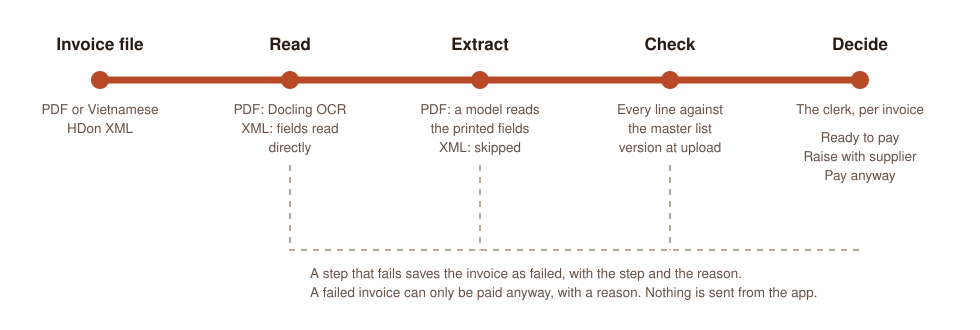

<div align="center">

# Invoice Checker

Checks each line of a supplier invoice against the prices agreed in a master list, and leaves the pay decision to the accounts clerk.

<picture>
  <source media="(prefers-color-scheme: dark)" srcset="docs/how-it-works-dark.svg">
  
</picture>

<sub>The path of one invoice, drawn from <code>backend/api/processing.py</code>. It is a diagram, not a screenshot.</sub>

</div>

## Why

An accounts clerk compares every invoice line with the agreed price sheet by hand, and invoices arrive as scans in many layouts. The checker reads the invoice and flags each line that differs from the master list. When it is unsure, it says so with a reason and reports no overcharge total, so "All match" means the invoice can be paid. The clerk then marks it Ready to pay, Raise with supplier, or Pay anyway.

## What it does

- Reads a PDF (up to 20 MiB, 1 to 30 pages) with Docling OCR, then a model fills the printed fields. Vietnamese HDon XML is read directly, with no OCR or model.
- Uploads one file at a time or in batches. ZIP and RAR archives (up to 50 MiB) are unpacked in the browser, with limits of 100 MiB expanded and 1,000 entries. Nested and password-protected archives are not unpacked.
- Checks each line against the uploaded master list (CSV, XLSX or XLS). Matching uses supplier, PO, invoice date, currency, item code and unit. A line with no code needs an exact description match. Price differences above 0.005 are flagged, undercharges included.
- Offers Ready to pay only when the check completed and every line matches. Ready-to-pay invoices export as CSV. An overcharge gives a dispute note to copy. Nothing is sent from the app.
- Keeps a private workspace per approved account. Administrators approve email addresses at `/admin/accounts`, users join from an emailed link at `/join`, and every sign-in needs an emailed security code. There is no public demo login. See the [backend setup](backend/README.md#approved-accounts-and-private-workspaces).
- Groups invoices into Invoice groups, each comparing against its own master list or just summing invoice totals. See [groups and the Supabase migration](docs/projects-and-supabase.md).

Keep the browser open until an upload finishes. Checking then continues on the server. Queued jobs need a running backend with persistent storage.

## Modes

- `INVOICE_MODE=live` runs the real reader and model.
- `INVOICE_MODE=fixture` replays known answers for the exact dummy PDFs in `data/dummy/` and refuses other files. It is not a live check and must not be used to measure accuracy. The screens label it.

## Evidence

All invoices, names and prices in the repo are invented. `data/mock_invoice_dataset/` holds 14 synthetic scanned invoices in seven layouts, a master price sheet and an answer key. A benchmark on 26 October 2026 ran those 14 PDFs (58 lines) through two model setups. Both finished all invoices and caught all seven intentional price errors. Line classifications were 57 of 58 correct for OpenAI and 58 of 58 for Ollama gemma4:e4b with qwen3.5:4b corrections. These are small, previously tuned synthetic samples and not a general accuracy estimate. Details: [benchmark](docs/review/2026-10-26-model-benchmark.md).

## Run it on your machine

You need Node 20.9 or newer, and Python with [uv](https://docs.astral.sh/uv/) for the backend.

```
npm install
npm run dev          # http://localhost:3000, reads the service at NEXT_PUBLIC_INVOICE_API
```

The service defaults to `http://127.0.0.1:8001`. Set up `backend/.env` and prepare the first administrator as described in [backend/README.md](backend/README.md), then, from `backend/`:

```
uv sync --locked --extra dev --extra docling --extra dummy
.venv/bin/python -m uvicorn api.app:app --env-file .env --host 127.0.0.1 --port 8001 --workers 1
```

Check `http://127.0.0.1:8001/health` for the mode before uploading.

## Checks

```
npm test             # Vitest
npm run lint
npm run typecheck
npm run build
```

From `backend/`:

```
.venv/bin/pytest -q --run-docling
.venv/bin/ruff check api read dummy schema.py invoice_processing tests
.venv/bin/ruff format --check api read dummy schema.py invoice_processing tests
```

The Docling tests convert real PDFs and may download model weights on the first run. They do not call a paid AI API.

## Where things are

| Path | What is in it |
| --- | --- |
| `src/app/` | The pages: `invoices`, `master-list`, `audit`, `account`, `admin`, `sign-in`, `join`, `setup`, `forgot-password`. |
| `src/checker/` | The API client, upload and archive handling, and the one module for labels and money formatting (`present.ts`). |
| `src/masterList/` | Master list import in the browser. |
| `backend/` | FastAPI service: `read/` (OCR and XML), `extract/` (model), `check/` (price check), `api/` (routes, accounts, queue), SQLite or Postgres storage. |
| `data/dummy/`, `data/mock_invoice_dataset/` | Invented invoices, price sheets and answer keys. |
| `docs/` | [API map](docs/API_MAP.md), [touchpoints](docs/TOUCHPOINTS.md), [handoff](docs/HANDOFF.md), code review notes in `docs/review/`, and the approved screens in `docs/design/`. |

Rules for people and AI assistants are in [CLAUDE.md](CLAUDE.md). This Next.js version differs from older ones; read the guide in `node_modules/next/dist/docs/` before changing code. Never commit a real client document, name, code or price, even redacted. `*.pdf` and `*.xlsx` are git-ignored except under `fixtures/`, `data/dummy/` and `data/mock_invoice_dataset/`.

## Deploy

The app is two deployments. The Vercel project is connected to this GitHub repo: every push builds a preview, and a merge to `main` deploys the screens to production. The service is deployed by hand from a checkout.

| Piece | Where | URL |
|---|---|---|
| Screens (Next.js) | Vercel, project `invoice-checker` | https://invoice-checker-cs3216.vercel.app (also `-wheat`) |
| Service (FastAPI) | Railway, project `invoice-checker`, service `invoice-api` | https://invoice-api-production-1f3a.up.railway.app |

**Screens (Vercel).** Add `NEXT_PUBLIC_INVOICE_API=/api` to the Vercel environment being
deployed, then rebuild/redeploy. The existing `vercel.json` forwards `/api/*` to the Railway
service above. Update that rewrite destination if the backend URL changes. This keeps API
requests and login cookies on the frontend's hostname. Keep the localhost API URL in local
`.env.local` only. Backend secrets must never have a `NEXT_PUBLIC_` prefix.

**Backend (Railway).** The current image is built from the repository root with
`RAILWAY_DOCKERFILE_PATH=backend/Dockerfile`. Add the following in the service's Variables
settings, replacing the example frontend, inbox and private values:

```dotenv
AUTH_REQUIRED=1
AUTH_SECRET=<persistent-random-secret-at-least-32-characters>
AUTH_ADMIN_EMAIL=owner@example.com
AUTH_EMAIL_PROVIDER=agentmail
AGENTMAIL_API_KEY=<private-send-only-agentmail-key>
AGENTMAIL_INBOX_ID=your_sender@agentmail.to
FRONTEND_URL=https://your-frontend.vercel.app
INVOICE_ALLOWED_ORIGINS=https://your-frontend.vercel.app
INVOICE_MODE=live
INVOICE_CHECKER=master_list
INVOICE_DATA_DIR=/data
INVOICE_OCR_TIMEOUT=180
OPENAI_MODEL=gemma4:e4b
OLLAMA_BASE_URL=http://your-private-ollama-host:11434
OLLAMA_CHALLENGER_MODEL=qwen3.5:4b
OPENAI_API_KEY=ollama
```

Use the same private AgentMail sending key that is saved locally in `backend/.env.email`;
Git and the Docker image deliberately exclude local environment files. Preserve an existing
production `AUTH_SECRET`; for a new environment generate a separate random secret and keep
it stable across redeploys. `AUTH_MFA_KEY` is optional; preserve it too if already configured.
The administrator email controls first-account setup. With an empty cloud database, open
`/setup`, verify the emailed code and choose credentials. Every subsequent sign-in requires
a new email code. No environment password, Resend key or Brevo key is needed with AgentMail.

**Keeping the existing Gemma server.** Both `gemma4:e4b` and the configured challenger must
be available in Ollama. The app uses the native Ollama API whenever `OLLAMA_BASE_URL` is set.
`OPENAI_API_KEY=ollama` is a compatibility placeholder for the current live-startup validation,
not an OpenAI credential; it must not be used for a hosted OpenAI configuration. The local
Ollama address is private: a cloud container needs an actual route to that private network,
such as a correctly configured Tailscale connection. Setting `OLLAMA_BASE_URL` or a Tailscale
key alone does not join a network. **The current backend Dockerfile does not install or start
Tailscale.** Configure the cloud-side connection separately and verify the backend can reach
Ollama before testing PDF processing. Keep Ollama private; the machine hosting Gemma must
remain running while cloud jobs use it. XML invoices parse directly without calling Gemma,
although live startup still validates the model settings above.

**Persistent storage and background jobs.** Mount a Railway volume at `/data`; this is what
makes `INVOICE_DATA_DIR=/data` persistent. Setting the variable without mounting storage is
not enough. Keep the backend running (disable automatic sleeping for continuous processing)
and retain the Docker command's single worker. Already accepted uploads continue while the
browser is closed, provided the backend and required model server stay available.

**Supabase/Postgres (if used).** Keep the existing backend-only `DATABASE_URL`, or add the
Postgres connection string from Supabase's **Connect** dialog with TLS enabled
(`sslmode=require`). This is a database connection string, not the Supabase website URL or
an anon/service-role API key. Use a direct or session-pooler connection for the persistent
backend, depending on network support; the app also disables prepared statements for
transaction-pooler compatibility. The service initializes its private `invoice_checker`
schema. Source documents and queue records are stored in Postgres; `/data` is still needed
for durable Outlook tokens. Without `DATABASE_URL`, the database is SQLite under `/data`.
Keep the current production database/volume to retain users and invoices. Git does not copy
local accounts or documents to the cloud. The Invoice group wording change needs no database
migration; existing IDs, URLs and `project_id` fields stay compatible.

**Outlook import (optional).** Add `MICROSOFT_CLIENT_ID`, `MICROSOFT_CLIENT_SECRET` and
`MICROSOFT_REDIRECT_URI`. With the Vercel `/api` proxy above, register
`https://your-frontend.vercel.app/api/auth/outlook/callback` in Microsoft and use that exact URL
for `MICROSOFT_REDIRECT_URI`, so the browser returns to the same hostname that issued the
login/OAuth cookies. `MICROSOFT_TENANT_ID` is optional and defaults to `common`.

Redeploy the updated backend and frontend together after setting their variables. A feature
branch push does not merge `main` or prove that the production backend was redeployed.
Check the backend `/health`, then test administrator email verification, a personal invitation,
one XML invoice, one PDF invoice and a batch that completes after closing the browser.

Provider documentation: [Vercel environment variables](https://vercel.com/docs/environment-variables),
[Vercel API rewrites](https://vercel.com/docs/routing/rewrites),
[Railway volumes](https://docs.railway.com/volumes),
[Supabase database connections](https://supabase.com/docs/guides/database/connecting-to-postgres),
and [Tailscale container networking](https://tailscale.com/docs/concepts/userspace-networking).

## Help and maintainer

- Questions and bugs: open an issue on this repo.
- Maintainer: Chen Meng ([@cmengu](https://github.com/cmengu)).
- Built for the CS3216 (NUS) final project.
- Licence: none chosen yet.
